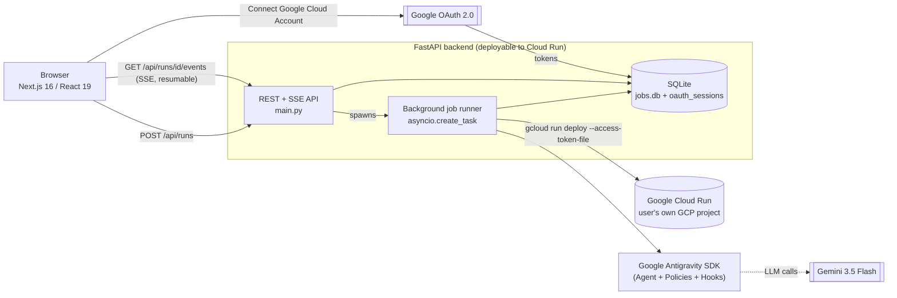
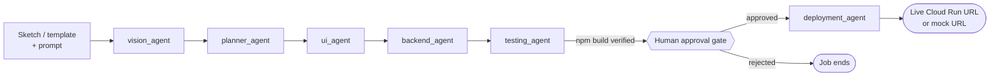

# Sketch2Cloud

**Sketch to production in minutes.** Upload a UI sketch, wireframe, or screenshot (or pick a template), and an autonomous team of **Google Antigravity SDK** agents analyzes the design, plans the architecture, generates full-stack code, self-heals build errors, and deploys the resulting app to Google Cloud Run — applying workspace governance, declarative safety policies, and a mandatory human-approval gate before anything goes live.

Built for the **All Things Agentic** workshop & hackathon — *The Future of Software Engineering: From Sketch to Cloud, the Agentic Way*.

## The problem

Turning a rough UI sketch into a deployed, working app is a long chain of manual chores: interpreting the design, scaffolding a frontend and backend, wiring them together, catching build errors, and deploying. Sketch2Cloud automates that whole chain as one governed agentic pipeline powered by the **Google Antigravity SDK** (`google-antigravity`) that runs in the background and pauses for human approval when it's about to provision real cloud resources.

## Features

- **Pre-pipeline Sketch Preview & Google ADK Comprehension**: as soon as you upload a sketch (or select a blueprint), **Google ADK** (`adk_sketch_interpreter_agent` via `LlmAgent` + `InMemoryRunner`) interprets the visual layout, extracts handwritten labels and wireframe regions, draws concrete layout conclusions, and shows you both your uploaded sketch and the AI's comprehension before the pipeline starts.
- **Sketch/template → running app**: a governed multi-agent pipeline (`vision_agent` → `planner_agent` → `ui_agent` → `backend_agent` → `testing_agent`) takes the ADK layout conclusions and writes a real Next.js + FastAPI application to disk.
- **Declarative governance & safety policies**: powered by `google.antigravity.hooks.policy` (`policy.workspace_only`, `policy.allow`, `policy.deny`) and `BudgetConfig` to isolate file operations strictly to the per-job workspace, block destructive shell commands or unauthorized deployments, and recover gracefully via `@hooks.on_tool_error`.
- **Self-healing build loop**: the testing agent runs `npm install` / `npm run build`, reads failures, patches the generated files, and re-runs until the build is clean — no human in that loop.
- **Background, resumable execution**: each pipeline run is a persisted job (SQLite-backed event log), not a single blocking HTTP request. Closing the tab or losing the connection doesn't lose progress — the frontend reconnects via Server-Sent Events (`Last-Event-ID`) and replays exactly where it left off.
- **Human approval gate before deployment**: the pipeline pauses after a verified build and waits for an explicit Approve/Reject decision before ever touching Cloud Run.
- **Per-user Google Cloud connection (not shared credentials)**: each browser session connects its *own* Google Cloud account via OAuth 2.0 and picks its *own* project. Deployment runs `gcloud run deploy` scoped to that one delegated access token (`--access-token-file`) — it never depends on, or falls back to, any ambient `gcloud auth` session on the server host. No account connected → deploys to a simulated sandbox URL instead, so the whole pipeline is always safe to demo.
- **Live code + app explorer**: a code tree of every generated file, a live log of agent reasoning and tool calls, and an iframe preview of the deployed/mock app.

## Tech stack

| Layer | Technology |
|---|---|
| LLM | Gemini 3.5 Flash |
| Sketch Vision & Comprehension | **Google ADK** (`google-adk`) — `LlmAgent`, `InMemoryRunner`, structured `SketchComprehensionResult` schema |
| Code Build & Governance | **Google Antigravity SDK** (`google-antigravity`) — `Agent`, `LocalAgentConfig`, `TemplatedSystemInstructions`, `policy`, `hooks`, `BudgetConfig` |
| Backend | FastAPI, Python, SQLite (job + OAuth session persistence), Server-Sent Events |
| Frontend | Next.js 16, React 19, Tailwind CSS 4 |
| Auth | Google OAuth 2.0 (Authlib) — per-user, delegated Cloud Run deployment |
| Cloud infra | Google Cloud Run (deployment target), Cloud Resource Manager API (project listing) |

## Architecture



**The agent pipeline itself:**



Why background jobs instead of one blocking request: the original design ran the whole agent pipeline inside a single streamed HTTP response — closing the tab killed the run, and there was no way to reconnect. `backend/jobs.py` persists every Google Antigravity SDK event to SQLite as it's produced, keyed by job id; `GET /api/runs/{id}/events` tails that log and honors the browser's `Last-Event-ID` header, so a dropped connection or page refresh just resumes the stream instead of losing it.

Why OAuth instead of the server's own `gcloud auth`: shelling out to `gcloud run deploy` with no other guard means it silently deploys to whatever project the *host machine's* CLI happens to be logged into — dangerous on any shared or long-lived server. `deploy_workspace_app` (`backend/agents/agent.py`) only ever deploys using a token minted by the *connecting browser's* own OAuth consent (`backend/oauth_sessions.py`), passed per-invocation via `gcloud`'s `--access-token-file` flag. No connected account → mock deployment, always, regardless of what's logged into the host.

## Project layout

```
backend/
  main.py            FastAPI app: REST/SSE API, background job orchestration, OAuth routes
  jobs.py             SQLite-backed job + event-log store
  oauth_sessions.py   SQLite-backed per-browser OAuth session/token store
  agents/agent.py     Google Antigravity SDK agents, declarative safety policies, and lifecycle hooks
frontend/
  src/app/page.tsx    The entire UI: template picker, pipeline timeline, live logs, code explorer
workspace/generated_app/   Where the agents write the app they generate (gitignored)
```

## Spin-up instructions

### Prerequisites
- Python 3.11+, Node.js 18+, the `gcloud` CLI installed (used to execute the actual deploy, `gcloud --version` to check)
- A Gemini API key ([aistudio.google.com](https://aistudio.google.com))
- Optional but required for real (non-mock) deployment: a Google OAuth 2.0 Client ID

### 1. Backend

```bash
cd backend
python -m venv venv
venv\Scripts\activate        # Windows
# source venv/bin/activate   # macOS/Linux
pip install -r requirements.txt
```

Create `backend/.env`:

```ini
GOOGLE_API_KEY=your_gemini_api_key
GEMINI_API_KEY=your_gemini_api_key

# Optional - LLM model id for every agent (default: gemini-3.5-flash).
# gemini-3.7-flash is also stable if you want the newer one.
GEMINI_MODEL=gemini-3.5-flash

# Optional - only needed for real (non-mock) Cloud Run deployment.
# Create a Web application OAuth Client in Google Cloud Console
# (APIs & Services > Credentials) with this exact redirect URI:
#   http://localhost:8080/api/gcloud/oauth/callback
# and scopes: openid, email, https://www.googleapis.com/auth/cloud-platform
GOOGLE_OAUTH_CLIENT_ID=
GOOGLE_OAUTH_CLIENT_SECRET=
OAUTH_REDIRECT_BASE_URL=http://localhost:8080
FRONTEND_BASE_URL=http://localhost:3000

# Optional - session cookie cross-site policy. Leave as "lax" for local dev
# (backend + frontend both on localhost). If you deploy the two to different
# domains, set COOKIE_SAMESITE=none (Secure is then forced on) or the browser
# won't return the session cookie on the OAuth redirect / SSE stream.
COOKIE_SAMESITE=lax
COOKIE_SECURE=

# Optional - encrypt OAuth tokens at rest. Generate with:
#   python -c "from cryptography.fernet import Fernet; print(Fernet.generate_key().decode())"
# Without it, tokens are stored in plaintext SQLite (a startup warning is printed).
TOKEN_ENCRYPTION_KEY=
```

Run it:

```bash
python -m uvicorn main:app --host 127.0.0.1 --port 8080 --reload
```

Run the backend tests (no API key or network needed):

```bash
pip install -r requirements-dev.txt
python -m pytest -q
```

### 2. Frontend

```bash
cd frontend
npm install
npm run dev
```

Optional `frontend/.env.local` if the backend isn't on `localhost:8080`:

```ini
NEXT_PUBLIC_API_URL=http://localhost:8080
```

Open `http://localhost:3000`. Pick a template or upload a sketch, click **Launch Pipeline**, and watch the pipeline run. Without connecting a Google Cloud account, deployment safely falls back to a simulated Cloud Run URL — the whole flow (including the approval gate) is demoable with zero cloud spend.

Once a run finishes, the chat box at the bottom sends a **refinement pass**: it seeds a new job from the finished run's generated files and runs a dedicated edit agent that applies just the requested change and re-verifies the build — it does not regenerate the app from the sketch.

### 3. (Optional) Connect a real Google Cloud account

With `GOOGLE_OAUTH_CLIENT_ID`/`SECRET` set, click **Connect Google Cloud Account** in the sidebar, sign in, pick a project you have Cloud Run + Cloud Build permissions on, and approve deployment when prompted — it will run a real `gcloud run deploy --source .` against that project, scoped to your own delegated token.

### Deploying this app itself to Cloud Run

Both `backend/` and `frontend/` ship a `Dockerfile` (+ `.dockerignore`) and can each be deployed with `gcloud run deploy --source .` from their own directory. The backend image is intentionally large — it bundles the `gcloud` CLI and Node.js because the pipeline shells out to both. If deployed publicly:

- set `OAUTH_REDIRECT_BASE_URL`/`FRONTEND_BASE_URL` (backend) and `NEXT_PUBLIC_API_URL` (frontend) to the deployed URLs;
- set `COOKIE_SAMESITE=none` on the backend (the two services are on different domains);
- add the backend's public `/api/gcloud/oauth/callback` URL as an additional authorized redirect URI on the OAuth client.

**What gets deployed for a *generated* app:** after a verified build, the pipeline writes a deterministic deploy scaffold into the job workspace — `Dockerfile`, `start.sh`, `.gcloudignore`/`.dockerignore`, and (when the generated app has a FastAPI backend) a `next.config.mjs` that rewrites `/api/*` to a co-located `uvicorn`. So one Cloud Run service fronts both the Next.js UI and the FastAPI API. The LLM agents never hand-roll container config.

## Known limitations / scope notes

**Persistence & job execution**

- Single-process background jobs (`asyncio.create_task` + SQLite). A restart mid-run no longer leaves a job stuck "running": `reconcile_orphaned_jobs()` marks orphaned `running`/`deploying` jobs as `error` on startup, and each phase has a wall-clock ceiling (`BUILD_PHASE_TIMEOUT` / `DEPLOY_PHASE_TIMEOUT`). But a job that was interrupted still *fails* rather than resuming — a production version would move execution to a real queue (Cloud Tasks / Pub/Sub) so runs survive a restart.
- One SQLite file (`jobs.db`) holds jobs, the event log, and OAuth sessions. `S2C_DB_PATH` overrides the location (used by the test suite); there's no connection pooling or migration framework beyond a hand-rolled `ALTER TABLE`.

**Auth & secrets**

- OAuth tokens are encrypted at rest with Fernet when `TOKEN_ENCRYPTION_KEY` is set; without it they fall back to plaintext SQLite (with a startup warning). Logout revokes the grant with Google, not just locally.
- The OAuth scope requested is the broad `cloud-platform` scope (needed since deployment spans Cloud Build, Cloud Run, and Resource Manager) — a real least-privilege tradeoff, not solved here.
- Jobs and workspace files are scoped to the browser's `s2c_session` cookie (a non-owner gets 404). That's ownership, not authentication — anyone holding the cookie value is the owner, and there are no user accounts.

**Deployment**

- Deployment shells out to the `gcloud` CLI (with a per-request delegated token via `--access-token-file`) rather than driving Cloud Build / Cloud Run over raw REST — this reuses `gcloud`'s already-correct source-to-container build logic instead of reimplementing it.
- A generated app is made deployable by a **deterministic scaffold** the pipeline writes after a verified build (`Dockerfile`, `start.sh`, `.gcloudignore`, and a `/api` proxy `next.config.mjs` when there's a FastAPI backend) — the LLM never hand-rolls container config. The scaffold assumes the generated app is Next.js (+ optional FastAPI under `api/`); a materially different stack wouldn't containerise correctly. It is written *after* the build-verification step, so the Dockerfile itself isn't build-tested in the pipeline.
- The mock (no-account) deployment returns a placeholder URL that doesn't resolve, so the App Preview tab shows a "simulated deployment" card instead of an iframe — inspect the generated app in the Code Explorer.
- The backend's own `Dockerfile` bundles the `gcloud` CLI and Node.js (the pipeline shells out to both), which makes that image large.

**Agent pipeline & governance**

- The build self-heal loop is capped at `MAX_BUILD_ATTEMPTS` (4) build runs; command execution is capped at `COMMAND_TIMEOUT_SECONDS` (600s) with a distinct `timed_out` status so an infra timeout isn't "fixed" as a code error. When the cap is hit the job reports the outstanding errors instead of looping.
- The refinement pass (chat box) seeds a new job from the previous run's files and runs a dedicated edit agent (`refine_agent`) — it does not re-run vision/planning. It rebuilds from a copied workspace (no `node_modules`), so the first `npm ci` of a refinement is a cold install.
- Each stage agent is configured via the **Google Antigravity SDK** (`LocalAgentConfig`, `TemplatedSystemInstructions`, `BudgetConfig`, `policy.workspace_only`, `policy.deny`, `policy.allow`, and `@hooks.on_tool_error`) so workspace isolation, command safety, and per-stage model/tool call budgets are enforced declaratively.

**Tested vs. not**

- `backend/tests/` covers the job state machine, orphan reconciliation, path-traversal guards, Google Antigravity SDK agent/policy configuration, session-ownership checks, token encryption/timezone handling, and the deploy scaffold — all runnable with no API key or network (`python -m pytest -q`).
- Not exercised by tests: live Gemini model calls, a real `docker build`, and a real `gcloud run deploy`.

## Findings & learnings

- The biggest correctness bug wasn't in the agents — it was in the human-approval gate. The original approval modal was purely cosmetic (its buttons didn't stop anything), and a test run of the fixed approval flow immediately surfaced a second, more serious issue: gating on the *server host's* ambient `gcloud` credentials meant a routine test could silently deploy to a real, unrelated GCP project. That's what drove the move to per-user OAuth with a token passed explicitly per deploy invocation, instead of any form of ambient/shared credential.
- Persisting the agent event log (rather than only streaming it) turned out to be the key architectural unlock for making the pipeline feel "background" rather than "long HTTP request" — it's a small change (SQLite table + SSE resume via `Last-Event-ID`) with an outsized effect on how the system behaves under real-world conditions like dropped connections.
